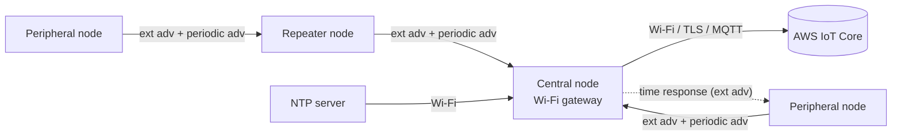

# esp32c6-ble5-multihop-relay-aws-iot

ESP32-C6 firmware that builds a small **Bluetooth 5 network** out of three node roles (**central**, **peripheral**, **repeater**), keeps the nodes **time-synchronised over BLE**, and connects Wi-Fi-capable nodes to **AWS IoT Core** over MQTT with mutual TLS.

Nodes discover each other with **extended advertising (2M PHY)** and exchange data through **periodic advertising sync**, so no connection is held open between them. A node with Wi-Fi acts as a gateway; nodes without Wi-Fi reach it through a repeater.

> Status: working prototype. Credentials, certificates and network addresses in this repository are placeholders (see [Configuration](#configuration)).

## Features

- **Three BLE roles**, chosen at boot and changed at runtime:
  - **Central**: scans for peripherals, creates periodic-advertising syncs, and acts as the gateway when it has Wi-Fi.
  - **Peripheral**: advertises extended and periodic packets and waits for a parent.
  - **Repeater**: runs the central and peripheral roles at the same time to relay between them. It is demoted to peripheral when both BLE links are lost.
- **Device-type lookup table** (power source, Wi-Fi standard, sync state) that maps each node to a short code (A0, B1C, C2R and so on). The code is sent in the advertising payload so neighbours can decide which role to take.
- **BLE time sync**: the central gets UTC from an NTP server over Wi-Fi. A peripheral asks for the time with an extended-advertising message and the central answers with the current seconds value, which the peripheral applies with `settimeofday()`.
- **Wi-Fi station** with an exponential-backoff reconnect timer and detection of the AP's Wi-Fi generation (802.11ax / ac / older), which feeds the role logic.
- **MQTT over TLS to AWS IoT Core** using the ESP-IDF MQTT client and embedded device certificates.
- **Sensor input**: TLV493D 3D magnetic sensor, with the angle converted to a percentage value and packed into an Eddystone-UID-style frame.
- **Low power**: automatic light sleep (160 MHz max, 40 MHz min) and Wi-Fi modem power save.
- **FreeRTOS** task structure: role management, deferred central start, Wi-Fi status monitoring, and an advertising-command executor that serialises BLE controller commands.

## Architecture



### Role selection

| Event | Resulting role |
|---|---|
| Boot, Wi-Fi available | Central |
| Boot, no Wi-Fi | Peripheral |
| Wi-Fi disconnected | Peripheral |
| ACK received from a synced parent | Peripheral or Repeater, depending on the parent's device code |
| Sync to parent lost | Peripheral |
| Repeater loses both central and peripheral links | Demoted to Peripheral |

The Wi-Fi/power/sync state can be read either from GPIO inputs (buttons or jumpers) or from the Wi-Fi scan result, depending on build flags.

## Source layout

| File | Purpose |
|---|---|
| `periodic_adv_demo.c` | `app_main`: init, BLE stack, Wi-Fi, timers, FreeRTOS tasks |
| `central.c` / `peripheral.c` / `repeater.c` | Role-specific BLE behaviour |
| `common.c` | Code shared by all roles |
| `ble_node_context.c` | Global node context and its initialisation |
| `ble_comm_struct.c` | Shared communication state and advertising payload templates |
| `ble_sync_utils.c` | Periodic advertising sync creation |
| `device_type_utils.c` | Device-type lookup table and role derivation |
| `time_sync.c` | BLE time request/response handling |
| `ntp.c` | SNTP client and discovery-window scheduling |
| `wifi.c` | Wi-Fi station, reconnect logic, role update task |
| `mqtt_module.c` | MQTT client for AWS IoT |
| `sensor_module.c` | TLV493D sensor driver and value conversion |

## Hardware

- ESP32-C6 development board
- TLV493D 3D magnetic sensor (I2C)
- Optional buttons or jumpers for the power/sync/Wi-Fi configuration inputs
- [TODO: pin assignments, for example the I2C pins and the four config input pins]

## Requirements

- ESP-IDF v5.5.1
- Bluedroid host stack with BLE 5 extended and periodic advertising enabled (see `sdkconfig.defaults`)
- An AWS account with an IoT Core "Thing", its certificate and private key, and an attached policy
- An NTP server reachable from your network (a local one, or `pool.ntp.org`)

## Configuration

All credentials and addresses in this repository are placeholders. Replace them before you build.

1. **Wi-Fi**: set `.ssid` and `.password` in `configure_wifi()` in `wifi.c`.
2. **NTP server**: set `LOCAL_NTP_SERVER_IP` in `ntp.c`.
3. **AWS IoT endpoint and client ID**: set the broker URI and `client_id` in `mqtt_app_start()` in `mqtt_module.c`. The endpoint is in the AWS console under IoT Core, Settings.
4. **Certificates**: the project embeds three files into the firmware through `EMBED_TXTFILES` in `CMakeLists.txt`:
   - `client.crt`: your device certificate
   - `client.key`: your device private key
   - `mosquitto.org.crt`: the root CA file. For AWS IoT, put the Amazon Root CA 1 certificate here (the file name is a leftover from the Mosquitto test broker).

   The files in this repository contain placeholder text so the project compiles. Replace them with real files, and **never commit your private key**.

## Build and flash

```bash
idf.py set-target esp32c6
idf.py build
idf.py -p <PORT> flash monitor
```

Without real certificates the project still builds, but the TLS connection to AWS fails at runtime. This is expected.

## How it works, in brief

1. At boot each node reads its power, sync, and Wi-Fi state, looks up its device code, and picks an initial role.
2. Peripherals send extended advertising packets (2M PHY) carrying the device code and a message type, plus periodic advertising for data.
3. A central scans, finds peripherals, and creates periodic-advertising syncs to them. A node that syncs to a central can be promoted to a repeater and then relays for nodes further out.
4. The central connects to Wi-Fi, gets UTC from NTP, and schedules its discovery windows to the start of each UTC minute. Peripherals request the time over BLE and align their clocks.
5. The central publishes to AWS IoT Core over MQTT with mutual TLS.

## Known limitations

- Prototype: the MQTT publish path for sensor packets is partly commented out while the topic structure is being finalised.
- Wi-Fi, NTP and AWS settings are compile-time constants, not runtime provisioning.
- [TODO: add anything else you know, for example the maximum tested hop count or node count]

## Roadmap

- [ ] Runtime Wi-Fi provisioning over BLE
- [ ] OTA firmware update
- [ ] Kconfig options for the settings listed under Configuration
- [ ] Test results: latency and power measurements

## License

This project is licensed under the MIT License - see the [LICENSE](LICENSE) file for details.

## Author

Muhammad Usman, embedded systems and IoT firmware engineer.
[GitHub profile](https://github.com/iamcalledusman)
